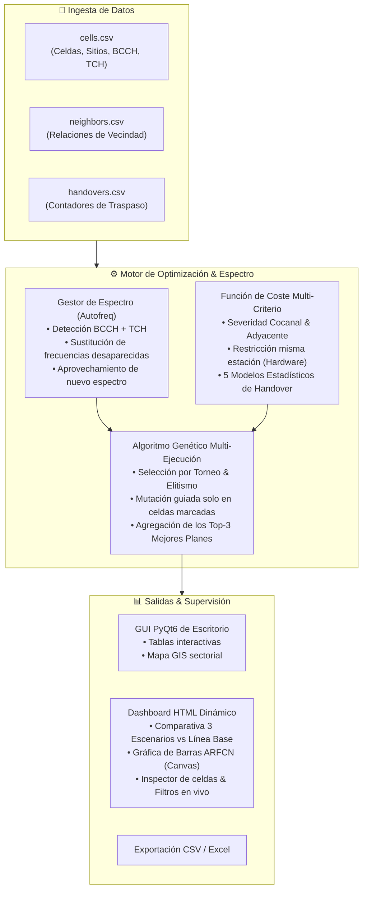

<div align="center">

# 📡 Freq Planner 2G
### Suite Profesional de Planificación y Optimización de Frecuencias GSM con IA

[](https://www.python.org/)
[](https://riverbankcomputing.com/software/pyqt/)
[]()
[](docs/index.html)
[](LICENSE)

<p align="center">
  <b>Eliminación de interferencias cocanal y adyacente • Reconfiguración adaptativa de espectro • Modelos estadísticos de tráfico • Dashboard interactivo dinámico</b>
</p>

[🌐 Ver Página Web Oficial del Proyecto](docs/index.html) • [📊 Explorar Demo del Dashboard](test_data/informe_comparativo_ejemplo.html) • [🚀 Guía Rápida](#-instalación-y-ejecución)

</div>

---

## 📋 Tabla de Contenidos

1. [Visión General & Problema NP-Hard](#-visión-general)
2. [Arquitectura y Módulos del Sistema](#-arquitectura-del-sistema)
3. [Reconfiguración Inteligente de Espectro (`Autofreq`)](#-reconfiguración-inteligente-de-espectro-autofreq)
4. [Modelos Estadísticos de Handovers (Pesos Matemáticos)](#-modelos-estadísticos-de-handovers)
5. [Dashboard HTML Dinámico Interactivo](#-dashboard-html-dinámico-interactivo)
6. [Estructura y Formato de Datos de Entrada](#-formatos-de-datos-de-entrada)
7. [Instalación y Ejecución](#-instalación-y-ejecución)
8. [Pruebas Automatizadas](#-pruebas-automatizadas)

---

## 🎯 Visión General

La asignación de frecuencias en redes celulares GSM 2G es un problema clásico de **coloración de grafos ponderada (NP-Hard)**. La reutilización excesiva del espectro radioeléctrico genera severas interferencias que degradan los indicadores clave de rendimiento (KPIs), provocando llamadas caídas (*Call Drop Rate*), cortes de traspaso (*Handover Failures*) y baja calidad de voz (*RxQual*).

**Freq Planner 2G** resuelve este desafío combinando:
- **Heurísticas de dominio de radiofrecuencia**: Detección holística de canales (BCCH y TCH) y recolocación voraz.
- **Algoritmo Genético Multi-Poblacional**: Búsqueda estocástica guiada que minimiza una función de coste global multi-criterio.
- **Modelado Estadístico de Tráfico Real**: Ajuste dinámico de penalizaciones según matrices de traspaso (*handover counters*).
- **Supervisión Ejecutiva e Interactiva**: Sustitución de informes PDF estáticos por un dashboard web dinámico con gráficas de carga espectral y comparativa de 3 escenarios calculados.

---

## 🏛️ Arquitectura del Sistema



---

## 📻 Reconfiguración Inteligente de Espectro (`Autofreq`)

Cuando un operador móvil experimenta una reasignación de frecuencias o liberación de espectro (refarming regulatorio), el plan debe adaptarse sin degradar la red:

1. **Detección Exhaustiva del Rango de Operación**:
   - Escanea todos los canales de la red considerando tanto la portadora de control (**BCCH**) como todas las frecuencias de tráfico (**TCH / Hopping**) presentes en cada sector.
2. **Identificación Diferencial de Espectro**:
   - $\text{Desaparecidas} = \text{Espectro Inicial} \setminus \text{Espectro Final}$
   - $\text{Nuevas} = \text{Espectro Final} \setminus \text{Espectro Inicial}$
3. **Modos de Actuación**:
   - **Sustitución Heurística Inmediata (Voraz)**: Reemplaza al instante cualquier frecuencia obsoleta por el canal disponible con menor riesgo de conflicto local.
   - **Optimización Global Guiada**: Marca automáticamente las celdas afectadas y lanza el motor genético para recalcular un plan globalmente balanceado aprovechando el nuevo espectro.

---

## 📐 Modelos Estadísticos de Handovers

Para evitar que celdas con alto tráfico monopolicen la penalización o que relaciones secundarias queden desprotegidas, el motor incorpora **5 modelos matemáticos** para calcular el peso de traspaso $w(\text{HO})$:

| Modelo | Formulación Matemática | Fundamento Estadístico | Caso de Uso Recomendado |
| :--- | :--- | :--- | :--- |
| **1. Logarítmico** *(Por Defecto)* | $$w(\text{HO}) = \log_2(1 + \text{HO})$$ | Compresión sublineal de varianza. Escala suave que amortigua picos extremos de tráfico. | **Redes urbanas y mixtas** densas con alta heterogeneidad de tráfico. |
| **2. Lineal Normalizado** | $$w(\text{HO}) = 1.0 + \frac{\text{HO}}{\overline{\text{HO}}}$$ | Relación directa proporcional normalizada respecto al promedio de la red. | Redes con **tráfico regular y homogéneo** entre sectores. |
| **3. Sigmoide (Curva S)** | $$w(\text{HO}) = \frac{10}{1 + e^{-k \cdot (\text{HO} - \text{HO}_{\text{mediana}})}}$$ | Función logística con punto de inflexión en la mediana. Alta sensibilidad ante umbrales. | Redes con **estrictos Acuerdos de Calidad (QoS)** y umbrales de saturación. |
| **4. Exponencial / Pareto (80/20)** | $$w(\text{HO}) = 1.0 + 9.0 \cdot \left(\frac{\text{HO}}{\text{HO}_{\max}}\right)^{1.5}$$ | Ley de potencia que prioriza drásticamente el 20% de adyacencias con el 80% de tráfico. | **Hotspots masivos**, estadios, centros comerciales y autopistas prioritarias. |
| **5. Uniforme / Clásico** | $$w(\text{HO}) = 1.0$$ | Tratamiento topológico puro sin ponderación por volumen de tráfico. | Fases preliminares de diseño o **cuando no hay datos de contadores**. |

---

## 🌐 Dashboard HTML Dinámico Interactivo

Dashboard Web dinámico, interactivo y 100% autocontenido ([`src/io/html_exporter.py`](src/io/html_exporter.py)):

### Capacidades Destacadas:
- 🌓 **Selector de Tema Claro / Oscuro**: Adaptación visual instantánea con paleta moderna y tipografías *Google Fonts*.
- ⚖️ **Comparador de Escenarios en Vivo**: Tarjetas conmutables para el **Plan Actual (Línea Base)** y hasta **3 Escenarios Calculados** (con indicador del recomendado). Al hacer clic en un escenario, todos los KPIs, tablas y gráficas se recalculan dinámicamente en el navegador sin recargar la página.
- 📊 **Gráfica de Barras Agregada por Canal**:
  - Visualiza el uso del espectro por canal (`ARFCN`).
  - Filtros interactivos: *Coincidencias Totales*, *Solo BCCH*, *Solo TCH*, *Conflictos / Coste*.
  - Modo comparativo con barras dobles (Plan Actual en gris vs Escenario en color vivo) para identificar canales descongestionados.
  - **Inspector de Celdas**: Al hacer clic en cualquier barra de canal, se despliega una tarjeta con el detalle de celdas asignadas (`Cell ID`, Estación, Sector y Rol).
- 📋 **Tabla de Celdas Filtrable**: Buscador en tiempo real por ID de celda, estación o sector, con opción toggle para *Mostrar solo celdas modificadas*.
- 📥 **Exportación Directa**: Botón para exportar las asignaciones a CSV y vista optimizada para impresión en papel o PDF.

> [!TIP]
> Puedes abrir directamente la previsualización del informe de ejemplo en tu navegador:
> [`test_data/informe_comparativo_ejemplo.html`](test_data/informe_comparativo_ejemplo.html)

---

## 📂 Formatos de Datos de Entrada

La aplicación carga la topología de la red mediante archivos CSV estándar:

### 1. `cells.csv` (Celdas y Portadoras)
```csv
cell_id,station_id,station_name,lat,lon,azimuth,bcch,tch_1,tch_2,tch_3
1011,101,EST_CENTRO,40.4168,-3.7038,0,102,105,107,110
1012,101,EST_CENTRO,40.4168,-3.7038,120,103,106,108,111
1013,101,EST_CENTRO,40.4168,-3.7038,240,104,109,112,
```

### 2. `neighbors.csv` (Relaciones de Vecindad)
```csv
source_cell,target_cell
1011,1012
1011,1021
1012,1013
```

### 3. `handovers.csv` (Tráfico y Traspasos)
```csv
source_cell,target_cell,ho_count
1011,1012,145
1011,1021,82
1012,1013,190
```

---

## 🚀 Instalación y Ejecución

### Prerrequisitos
- Python **3.9** o superior (recomendado Python 3.10 / 3.11 / 3.12 / 3.13)
- Gestor de paquetes `pip`

### Paso 1: Clonar el Repositorio
```bash
git clone https://github.com/angel190385/2G-Frequency-planner.git
cd 2G-Frequency-planner
```

### Paso 2: Instalar Dependencias
```bash
pip install -r requirements.txt
```

### Paso 3: Lanzar la Aplicación
```bash
python main.py
```

### Atajos de Teclado Útiles:
- `Ctrl+O`: Importar archivos CSV de celdas, vecindades y handovers.
- `Ctrl+R`: Configurar reglas de frecuencia y modelo estadístico.
- `Ctrl+E`: Exportar plan calculado a CSV.
- `Ctrl+H`: **Exportar Informe HTML Dinámico (3 Escenarios)**.

---

## 🧪 Pruebas Automatizadas

El proyecto cuenta con una suite completa de pruebas unitarias que validan el motor de optimización, el gestor de espectro, los modelos estadísticos y el generador de informes HTML:

```bash
python -m unittest tests/test_autofreq_features.py
```

Salida esperada:
```text
.......
----------------------------------------------------------------------
Ran 7 tests in 0.750s

OK
```

---

## 📄 Licencia

Este proyecto se distribuye bajo la licencia **MIT**. Consulta el archivo `LICENSE` para más detalles.

---

<div align="center">
  <sub>Desarrollado para la optimización y modernización de redes de telecomunicaciones móviles 2G GSM.</sub>
</div>
